# GRAINS

A granular sampler that runs in the browser. One HTML file, no build step, no dependencies. Built for touch screens (phones and tablets), and works with a computer keyboard too. Black and white, same design family as BEHEMOTH and ELEPHANT.

## Screenshots

  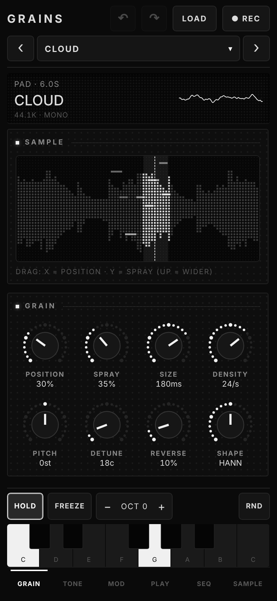
  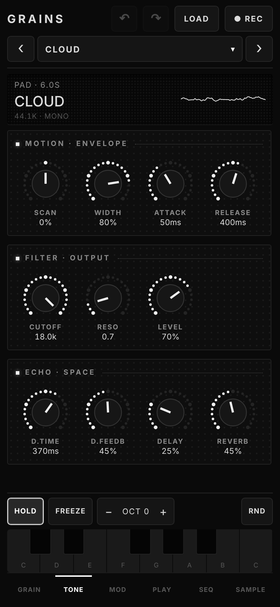
  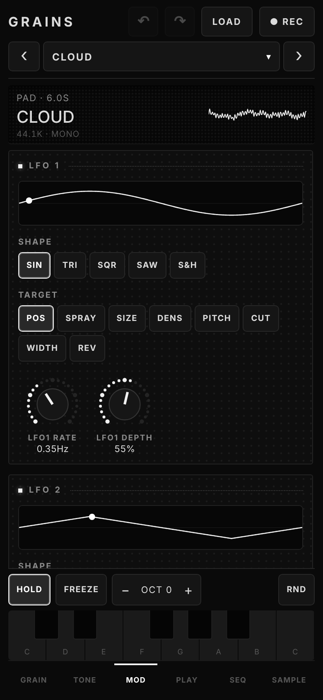
  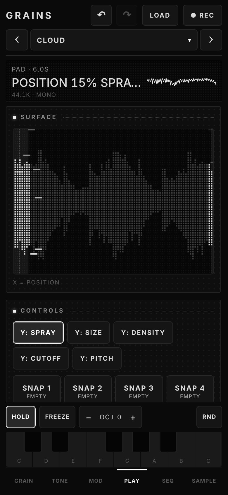

  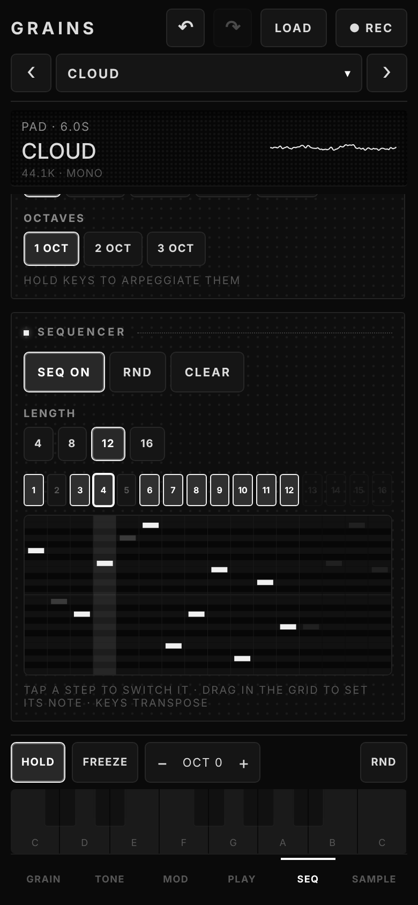
  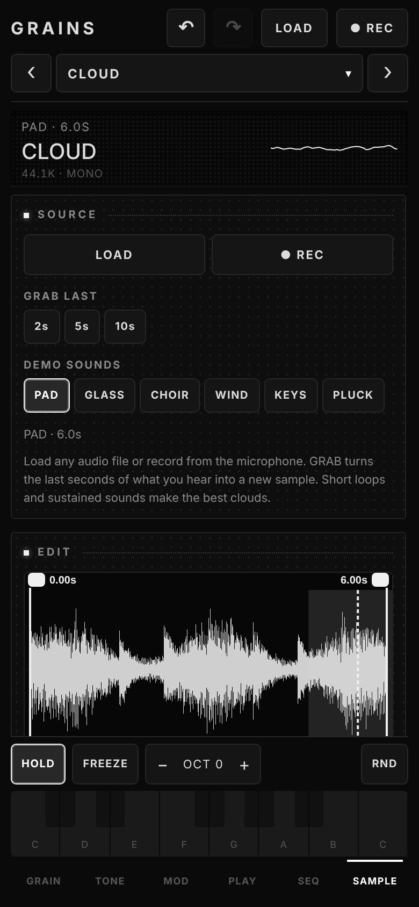
  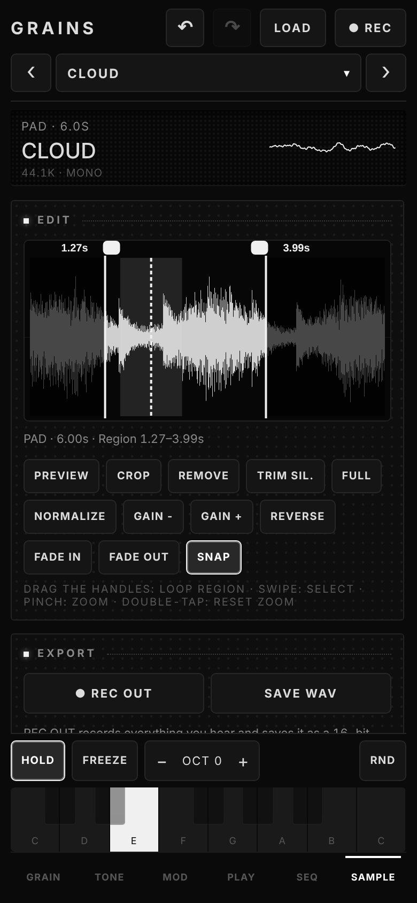
  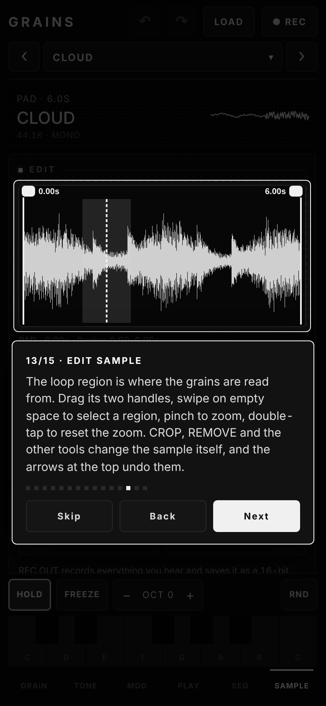

Landscape console layout:

  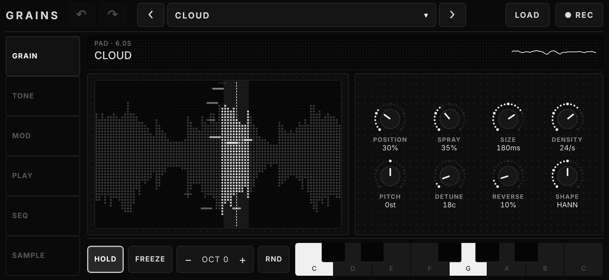
  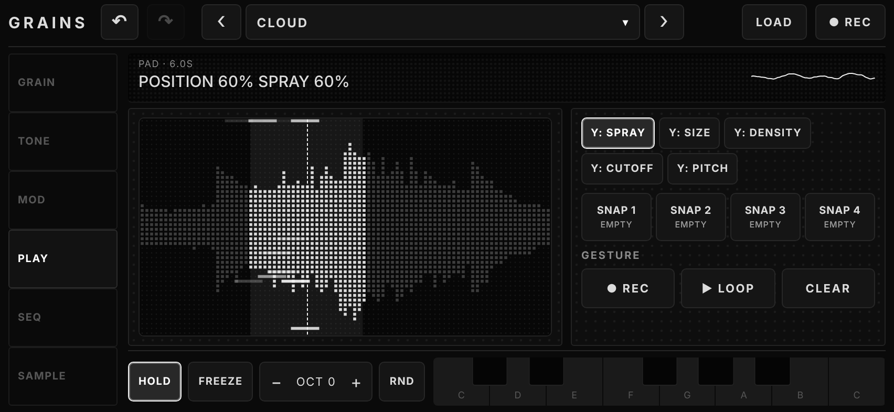

  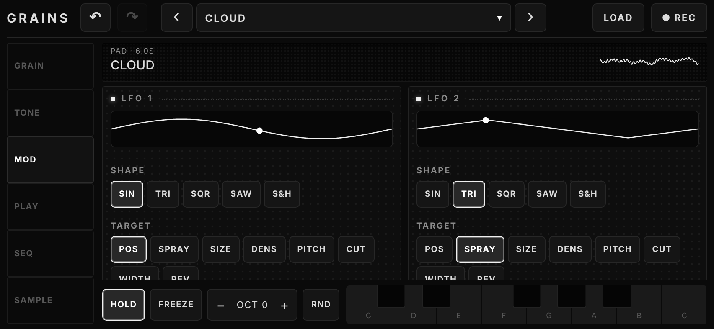
  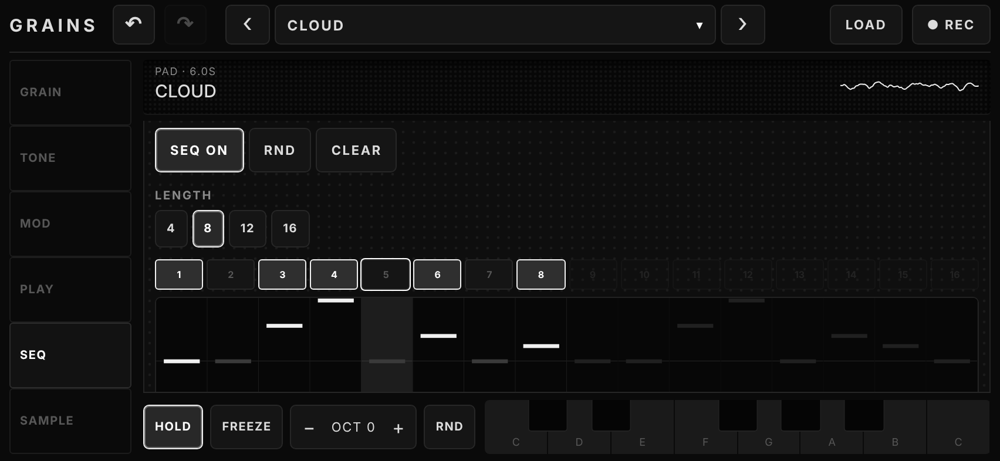

  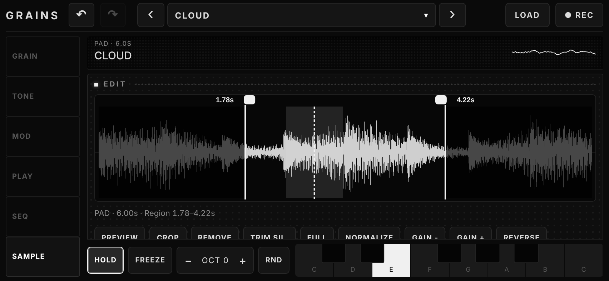

## Features

**Granular engine**
- Grains are scheduled ahead of time on the Web Audio clock: position, spray, size, density, pitch, detune, reverse chance and window shape
- Per-grain windowing and random stereo placement, with automatic gain compensation so dense clouds do not clip
- Lowpass filter with resonance, gate envelope, feedback echo, reverb and a master compressor
- Freeze: locks position and scan and sustains the cloud (grain size stays live)

**Modulation (MOD)**
- Two LFOs: sine, triangle, square, saw, sample and hold; each with rate, depth and a target (position, spray, size, density, pitch, cutoff, width, reverb)

**Playing**
- Keyboard with hold, octave shift and randomize; scale quantization (8 scales, any root) that also snaps Y:PITCH
- Play tab: full-size touch surface with a switchable Y axis, plus a gesture recorder that loops your finger movement
- 4 scenes (snapshots) to jump between sounds
- MIDI input (Web MIDI): notes, pitch bend, sustain pedal, CC map with LEARN (not available in iOS Safari)

**Arpeggiator and sequencer (SEQ)**
- Arpeggiator: up, down, up-down, random, order; 1-3 octaves; 1/4 to 1/32; gate and BPM
- 16-step sequencer with adjustable length

**Sample**
- 6 generated demo samples (pad, glass, choir, wind, keys, pluck), load your own audio, or record from the microphone
- Finger-controlled editor: drag the loop-region handles (snap to zero crossings), swipe to select, pinch to zoom, double-tap to reset zoom, tap to set position
- Tools: preview, crop, remove, trim silence, full, normalize, gain, reverse, fade in/out
- GRAB the last 2 / 5 / 10 s of output as a new sample; REC OUT and SAVE WAV export 16-bit WAV files

**Workflow**
- Undo / redo for parameters, loop region and sample edits
- Factory and user presets, saved in the browser
- Knobs: drag to turn, double-tap to reset
- Interface languages: English (default), Russian and Spanish; choose it in SAMPLE → Settings → Language, or pick Auto
- Step-by-step tutorial on first launch (replay it in SAMPLE → Settings) and contextual tips on each tab
- Portrait layout for phones, landscape console layout for wide screens

**Install**
- Installable as an app (PWA): fullscreen, works offline once loaded over HTTPS

**Limits**
- Undo does not cover LFO, arpeggiator, sequencer or scale settings; your own samples are not kept across reloads
- GRAB and REC OUT use the ScriptProcessor API, which is deprecated but still supported everywhere

## Run

Open `index.html` in a modern browser and tap the screen to start audio.

For install and offline use, serve the files over HTTPS, for example with GitHub Pages.

### GitHub Pages

Settings → Pages → Source: **GitHub Actions** (the included workflow deploys on every push to `main`), or Deploy from branch → `main` / root. The sampler is then available at `https://<user>.github.io/<repo>/`. On an iPhone or iPad use Share → Add to Home Screen, on Android use Install app in the browser menu.

## Files

| File | Purpose |
| --- | --- |
| `index.html` | The whole sampler: UI and audio engine (this is the file to open or deploy) |
| `manifest.webmanifest`, `sw.js`, `icons/` | Install and offline support (optional) |
| `screenshots/` | README screenshots |
| `.github/workflows/pages.yml` | GitHub Pages deployment |
| `LICENSE` | MIT |

## Development

There is nothing to build: edit `index.html` and reload. For a local server with HTTPS-like features (service worker), run `npx serve .` and open the printed address. When you change files that the offline cache lists in `sw.js`, bump the `V` cache name there.

## Browser support

Current Chrome, Edge, Safari and Firefox.

## License

[MIT](LICENSE)
