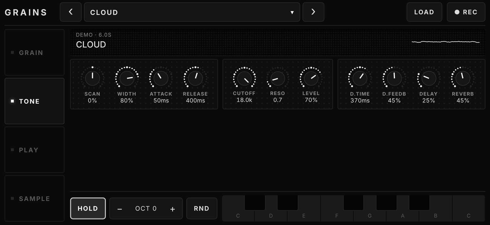
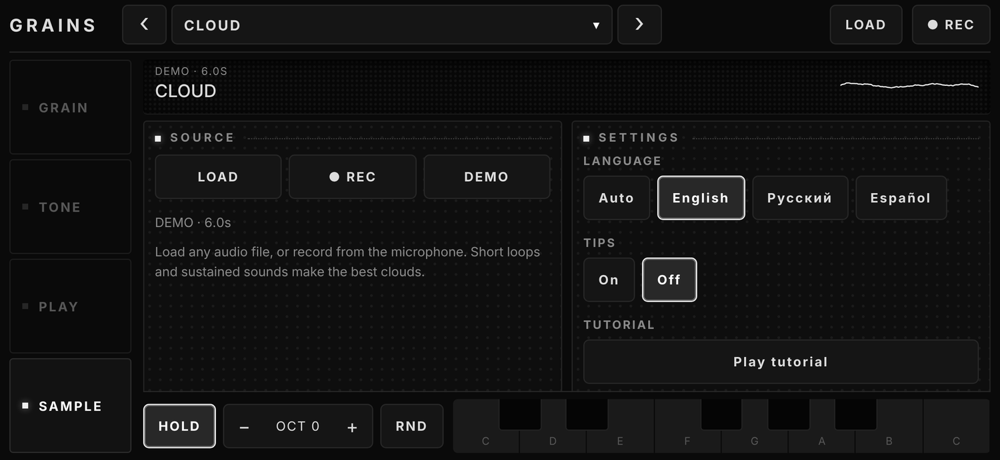

# GRAINS

A granular sampler that runs in the browser. One HTML file, no build step, no dependencies. Built for touch screens (phones and tablets), and works with a computer keyboard too. Black and white, same design family as BEHEMOTH and ELEPHANT.

Try it: open shoogaze.github.io/grains-synth on your phone and tap the screen to start audio. On an iPhone or iPad use Share → Add to Home Screen for a full-screen app.

## Screenshots

  
  
  
  
  

Landscape console layout:

  
  

  
  

## Features

**Granular engine**
- Grains are scheduled ahead of time on the Web Audio clock: position, spray, size, density, pitch, detune, reverse chance and window shape (Hann and others)
- Per-grain windowing and random stereo placement, with automatic gain compensation so dense clouds do not clip
- Lowpass filter with resonance, gate envelope (attack / release), feedback echo, reverb and a master compressor

**Sample**
- Built-in demo samples, load your own audio file or record from the microphone
- Pixel-matrix waveform: drag to set position and spray, bright dots show the grains that are playing now

**Playing**
- Keyboard with hold, octave shift and randomize
- Play tab: a full-size touch surface with a switchable Y axis (spray, size, density, cutoff, pitch)
- 4 scenes (snapshots) to jump between sounds

**Workflow**
- Factory and user presets, saved in the browser
- Record the output
- Knobs: drag to turn, double-tap to reset
- Interface languages: English (default), Russian and Spanish; choose it in SAMPLE → Settings → Language, or pick Auto to follow the browser language
- Step-by-step tutorial on first launch (replay it in SAMPLE → Settings) and contextual tips on each tab (can be switched off)
- Portrait layout for phones, landscape console layout (side rail, screens, keys) for wide screens

**Install**
- Installable as an app (PWA): fullscreen, works offline once loaded over HTTPS

## Run

Open `index.html` in a modern browser and tap the screen to start audio.

For install and offline use, serve the files over HTTPS, for example with GitHub Pages.

### GitHub Pages

Settings → Pages → Source: **GitHub Actions** (the included workflow deploys on every push to `main`), or Deploy from branch → `main` / root. The sampler is then available at `https://<user>.github.io/<repo>/`. On an iPhone or iPad use Share → Add to Home Screen, on Android use Install app in the browser menu.

## Files

| File | Purpose |
| --- | --- |
| `index.html` | The whole sampler: UI and audio engine (this is the file to open or deploy) |
| `manifest.webmanifest`, `sw.js`, `icons/` | Install and offline support (optional) |
| `screenshots/` | README screenshots |
| `.github/workflows/pages.yml` | GitHub Pages deployment |
| `LICENSE` | MIT |

## Development

There is nothing to build: edit `index.html` and reload. For a local server with HTTPS-like features (service worker), run `npx serve .` and open the printed address. When you change files that the offline cache lists in `sw.js`, bump the `V` cache name there.

## Browser support

Current Chrome, Edge, Safari and Firefox.

## License

[MIT](LICENSE)
