# GRAINS

A granular sampler and playable instrument that runs in the browser. One HTML file, no build step, no dependencies. Built for touch screens (phones and tablets), with a black-and-white interface from the same design family as BEHEMOTH and ELEPHANT.

Load or record a sound, then play it as a cloud of tiny grains: freeze it, move through it with your finger, modulate it with two LFOs, run it through an arpeggiator or a 16-step sequencer, and record the result.

## Screenshots

<p>
  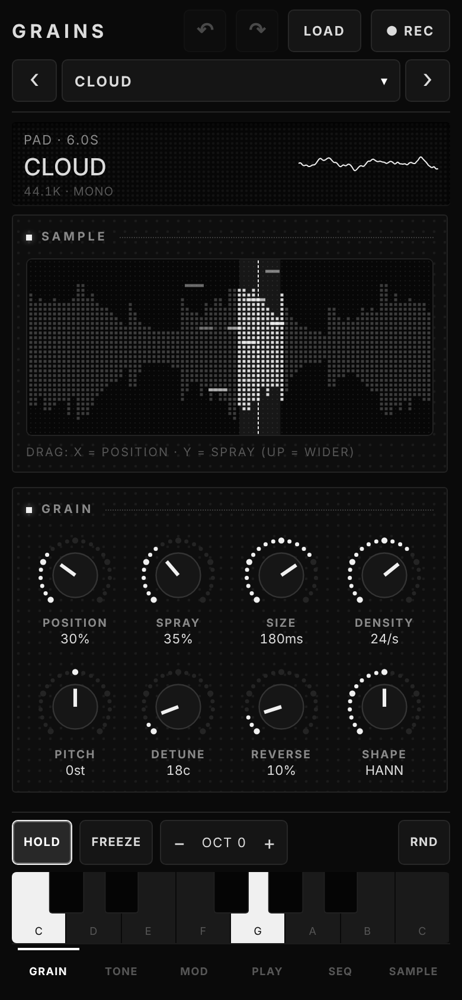
  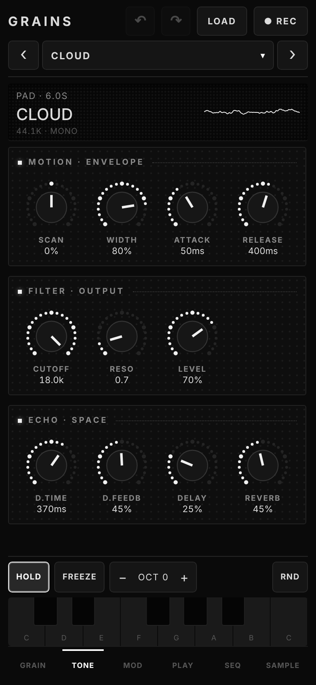
  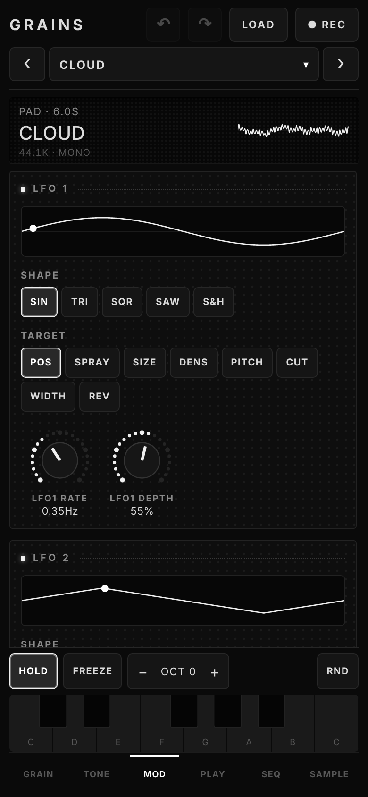
  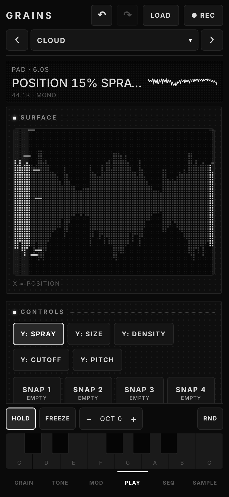
</p>

<p>
  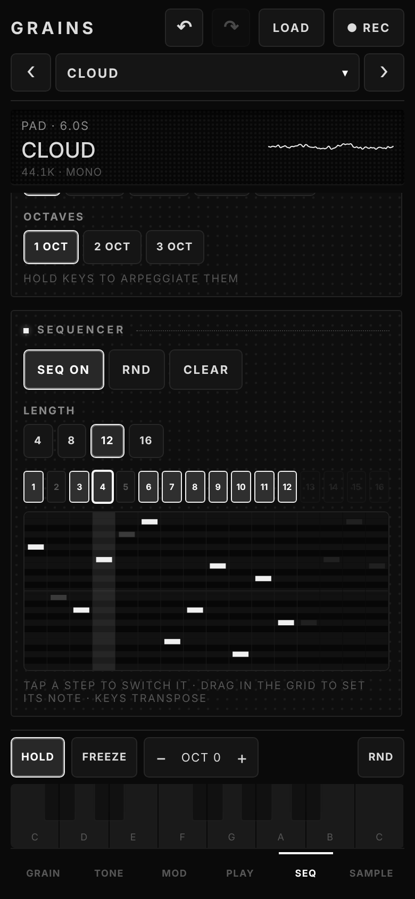
  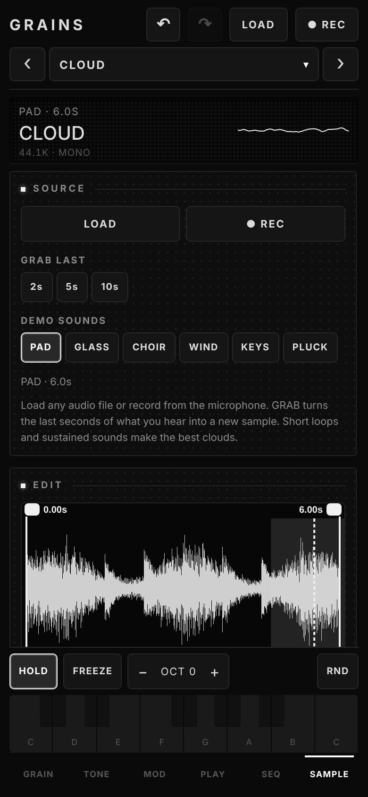
  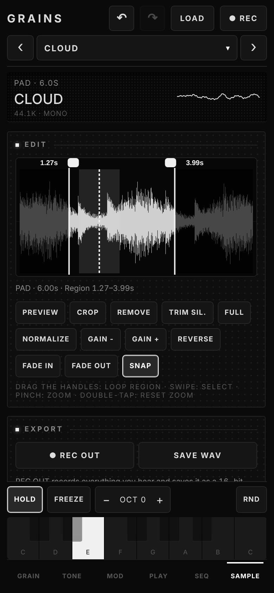
  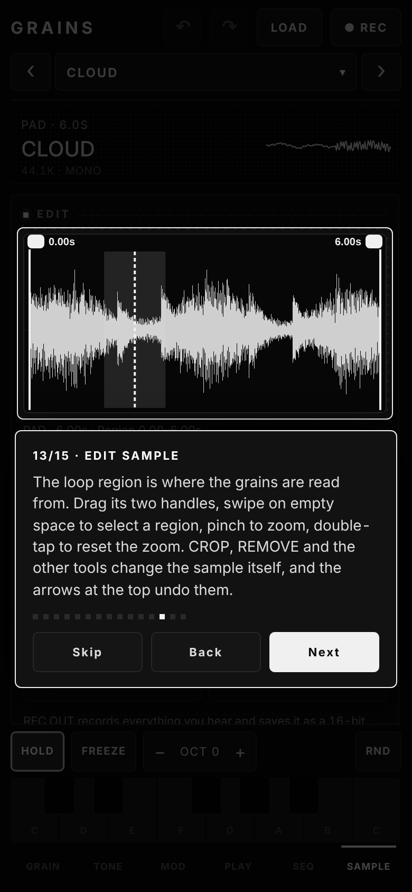
</p>

Landscape console layout:

<p>
  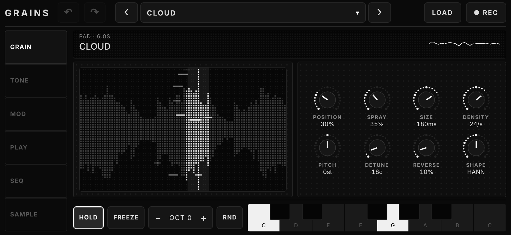
  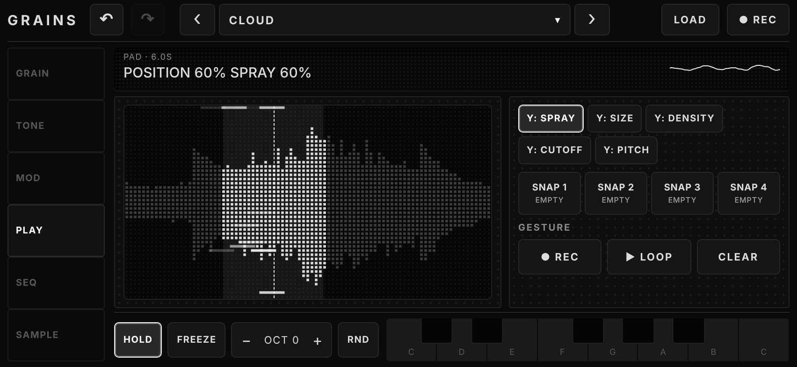
</p>
<p>
  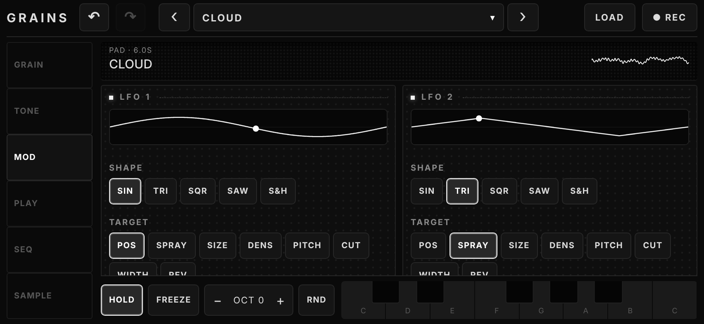
  
</p>
<p>
  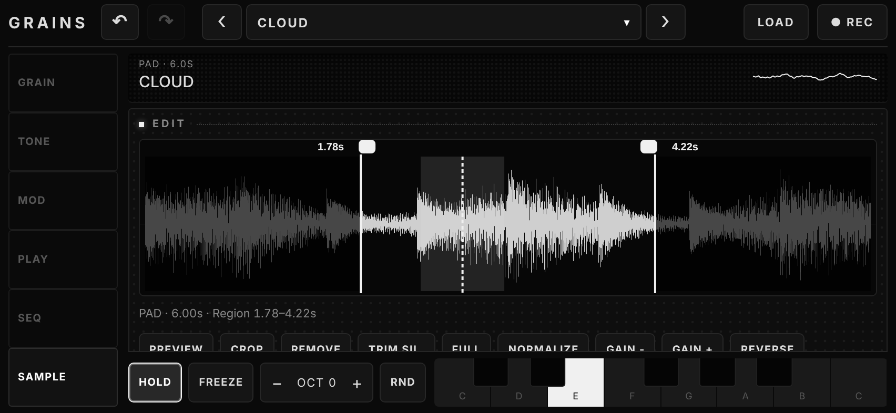
</p>

## Features

**Granular engine**
- Grains are scheduled ahead of time on the Web Audio clock: position, spray, size, density, pitch, detune, reverse chance and window shape (rect, Hann, percussive)
- Per-grain windowing and random stereo placement, with automatic gain compensation so dense clouds do not clip
- Scan, lowpass filter with resonance, attack / release envelope, feedback echo, reverb and a master compressor
- Freeze: locks position and scan and sustains the cloud (grain size stays live)

**Sample**
- 6 generated demo sounds (pad, glass, choir, wind, keys, pluck), your own audio files, or the microphone (up to 30 s)
- Finger-controlled editor with a non-destructive loop region: drag the two handles (they snap to zero crossings), swipe to select, pinch to zoom, double-tap to reset the zoom, tap to set the position
- Tools: preview, crop, remove, trim silence, full region, normalize, gain, reverse, fade in / out
- GRAB the last 2, 5 or 10 seconds of what you hear as a new sample
- REC OUT records the output, SAVE WAV exports the current sample; both write 16-bit WAV files and use the share sheet on phones

**Modulation (MOD)**
- Two LFOs: sine, triangle, square, saw, sample and hold; each with its own rate, depth and target (position, spray, size, density, pitch, cutoff, width, reverb)

**Playing**
- Keyboard with hold, octave shift and randomize
- Scale quantization: 8 scales, any root; it also snaps the Y:PITCH axis of the touch surface
- PLAY tab: a full-size touch surface (X = position, Y = spray, size, density, cutoff or pitch) and a gesture recorder that loops your finger movement
- 4 snapshots to jump between sounds, 11 factory presets and your own presets
- MIDI input (Web MIDI): notes, pitch bend, sustain pedal, a default CC map and LEARN (tap a knob, then move a controller)

**Arpeggiator and sequencer (SEQ)**
- Arpeggiator: up, down, up-down, random, order; 1 to 3 octaves; note length from 1/4 to 1/32; gate and BPM
- 16-step sequencer with adjustable length; drag in the grid to set the note of each step

**Workflow**
- Undo / redo for parameters, loop region and sample edits
- Knobs: drag to turn, double-tap to reset
- Interface languages: English (default), Russian and Spanish; choose it in SAMPLE → Settings → Language, or pick Auto to follow the browser language
- Step-by-step tutorial on first launch (replay it in SAMPLE → Settings) and contextual tips on each tab
- Portrait layout for phones, landscape console layout (side rail, screens, keys) for wide screens

**Install**
- Installable as an app (PWA): fullscreen, works offline once loaded over HTTPS

## Screens

| Tab | What is there |
| --- | --- |
| GRAIN | Dot-matrix sample view and the main grain knobs |
| TONE | Scan, filter, envelope, echo and reverb |
| MOD | Two LFOs |
| PLAY | Touch surface, Y-axis choice, snapshots, gesture looper |
| SEQ | Scale, arpeggiator, 16-step sequencer |
| SAMPLE | Load, record, grab, demos, editor, export, MIDI, settings |

## Notes and limits

- Web MIDI works in Chrome and Edge (desktop and Android). It is not available in iOS Safari, where the MIDI card just says so.
- Undo / redo covers parameters, the loop region and sample edits, but not LFO, arpeggiator, sequencer or scale settings.
- Your own samples are not kept after a reload. Presets and settings are saved in the browser.
- GRAB and REC OUT use the ScriptProcessor API, which is deprecated but still supported by current browsers.

## Run

Open `index.html` in a modern browser and tap the screen to start audio.

For install and offline use, serve the files over HTTPS, for example with GitHub Pages.

### GitHub Pages

Settings → Pages → Source: **GitHub Actions** (the included workflow deploys on every push to `main`), or Deploy from branch → `main` / root. The sampler is then available at `https://<user>.github.io/<repo>/`. On an iPhone or iPad use Share → Add to Home Screen, on Android use Install app in the browser menu.

## Files

| Path | Purpose |
| --- | --- |
| `index.html` | The whole sampler in one file: UI and audio engine. This is the file to open or deploy; it is generated from `src/` |
| `src/index.html` | HTML template (markup and the `<head>`) |
| `src/css/` | Styles, concatenated in file-name order |
| `src/js/` | The engine and UI, split by topic (`02-params`, `10-engine`, `17-sample-editor`, `20-midi` ...) and concatenated in file-name order into one scope |
| `build.mjs` | Builds `index.html` from `src/` (no dependencies) |
| `test/` | Headless Chrome tests (`app.test.mjs`, `ui.test.mjs`) |
| `manifest.webmanifest`, `sw.js`, `icons/` | Install and offline support |
| `screenshots/` | README screenshots |
| `.github/workflows/pages.yml` | Builds and deploys to GitHub Pages |
| `LICENSE` | MIT |

## Development

Edit the files in `src/`, then run:

```
node build.mjs     # writes index.html
npm test           # builds a test variant and runs the headless Chrome checks (needs Chrome; set CHROME=/path if it is not "google-chrome")
npx serve .        # local server, needed for the service worker
```

The JS files are joined into a single scope, so their order matters: a file may use what earlier files define. Commit the generated `index.html` too, so the repository can also be opened or deployed without a build step. When you add files to the offline cache in `sw.js`, bump the `V` cache name there.

## Browser support

Current Chrome, Edge, Safari and Firefox.

## License

[MIT](LICENSE)
